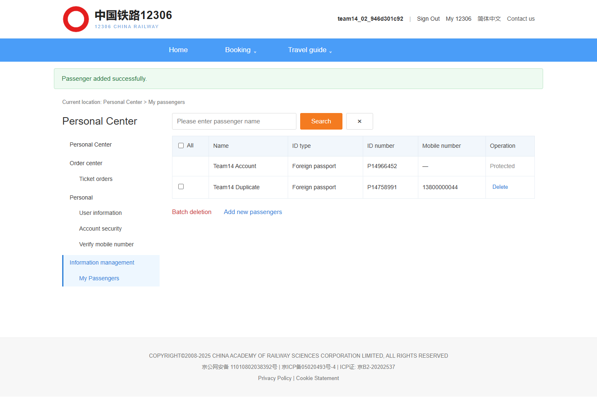
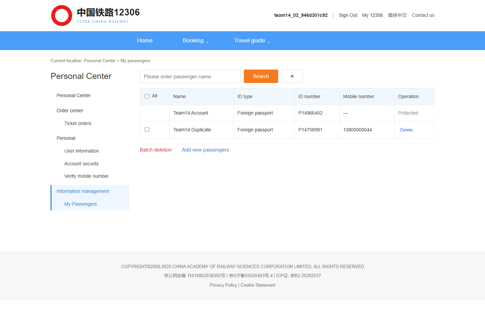

# 02 同名同护照绕过重复护照校验并改写手机号

## 测试方法与设计依据

采用白盒分支测试。检查 [`backend/app.py`](../../backend/app.py) 的 `_passenger_add` 后，针对 851–861 行的嵌套条件选择两组输入。共同前提是护照已存在、属于当前账号、记录为非账号持有人。

| 输入条件 | 代码中的分支 | 需求预期 |
| --- | --- | --- |
| 同护照、不同姓名 | 861 行抛出重复错误 | 拒绝重复护照 |
| 同护照、同姓名 | 852 行为真，853–860 行更新原记录并返回成功 | 同样拒绝重复护照 |

为使状态改写可见，重复提交时将 Mobile number 从 `13800000043` 改为 `13800000044`。原记录的内容完整性是本例的附加观察点。

## 需求与现有测试差异

[REQ-7.2](../../requirements/requirements.yaml) 声明重复护照显示 Passport number already exists.，拒绝时保留表单并新增零条乘客记录。该规则同样适用于姓名相同的输入。

[REQ-7.2.spec.ts](../baseline/REQ-7.2.spec.ts) 的重复测试先创建 Passenger Example，再用 Duplicate Passenger 和相同护照提交，执行的是不同姓名分支。本例以该拒绝路径作为对照，再把姓名改为原姓名以命中成功更新分支，同时核对手机号是否被改写。

## 前置条件与复现步骤

1. 按 [团队 README](README.md) 注册并登录独立账号，例如用户名 `team14_manual02`、账号护照 `P14000012`，打开 My 12306 → Information management → My Passengers。
2. 点击 Add new passengers，填写 Name `Team14 Duplicate`、未使用的 Passport number `P14000003`、Nationality China、Passport expiration date `2028-12-31`、Date of birth `1999-02-20`、Gender Male、Email address `team14.passenger@example.com`、Mobile number `13800000043`、Passenger type Adult，点击 Determine。
3. 确认新增成功，列表中的手机号为 `13800000043`。
4. 再次打开新增表单，使用同护照 `P14000003`、不同姓名 `Team14 Different Name`、手机号 `13800000044`，其他值保持有效，提交 Determine。
5. 确认出现 Passport number already exists. 且表单保留，然后点击 Cancel。
6. 再次打开新增表单，使用原姓名 `Team14 Duplicate`、原护照 `P14000003`、手机号 `13800000044`，提交 Determine。
7. 观察反馈和表单状态，刷新后检查原乘客的手机号。

## 预期与实际

预期步骤 6 同样出现 Passport number already exists.，新增表单保留，原乘客手机号继续为 `13800000043`。

实际不同姓名的对照提交得到 HTTP 400 与重复护照错误。同姓名提交得到 HTTP 200、Passenger added successfully.，表单关闭。刷新后，原乘客手机号已变成 `13800000044`。记录数量仍为一条，但新增操作悄然改写了已有数据。[原始响应和前后行文本](assets/results.json)

## 证据与复现命令

按团队 README 安装依赖、启动应用并设置 BASE_URL 后执行 `node reproduce.cjs 02`。当前实现的断言在“同名提交返回重复护照错误”处失败。
