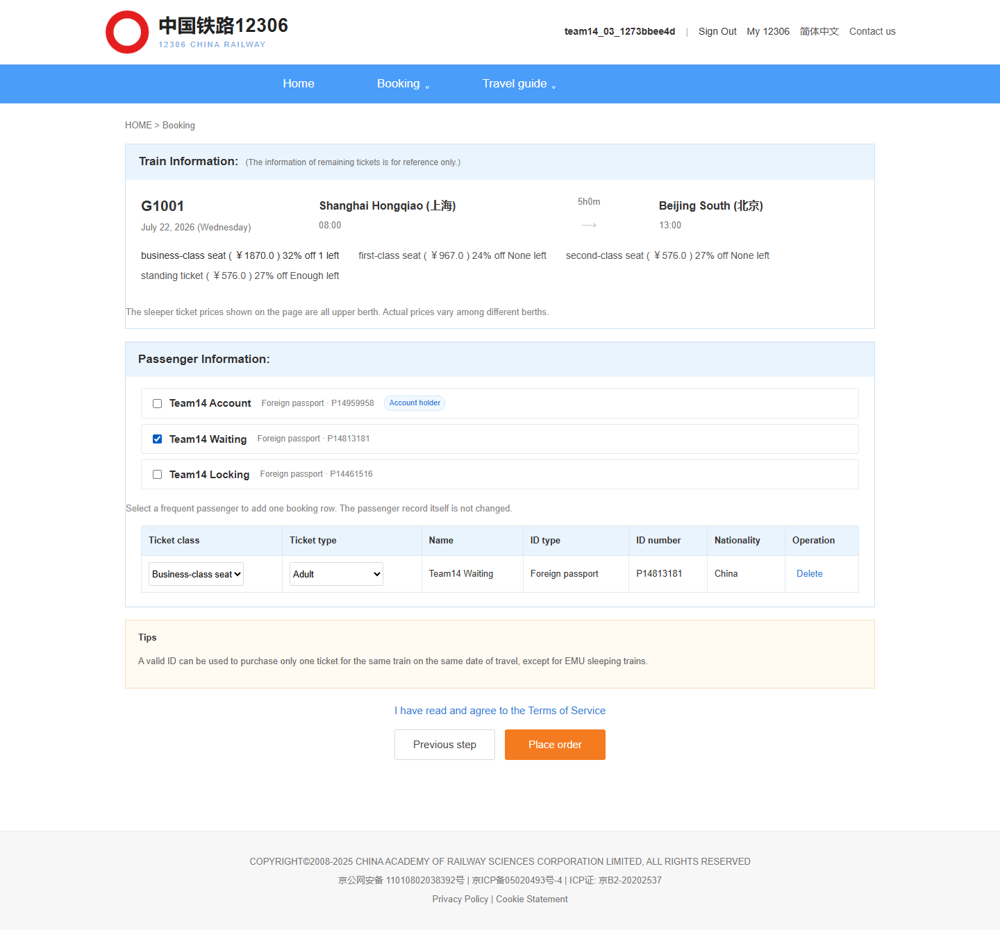
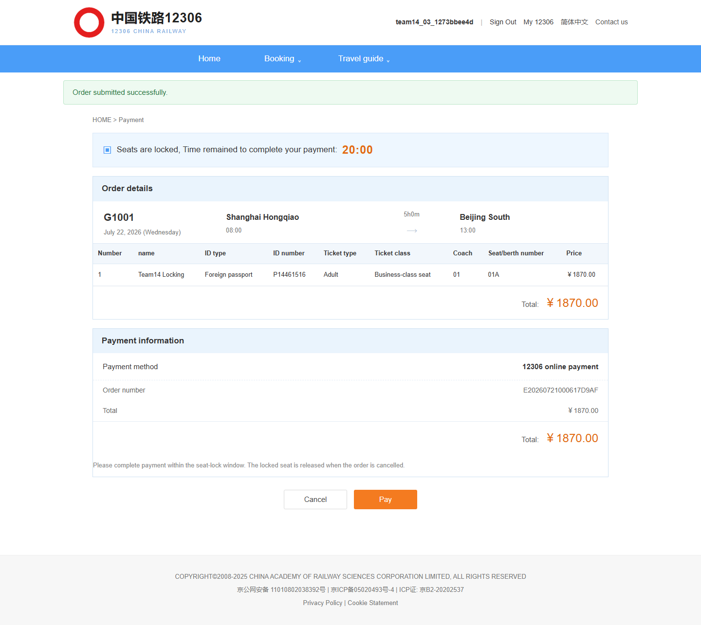
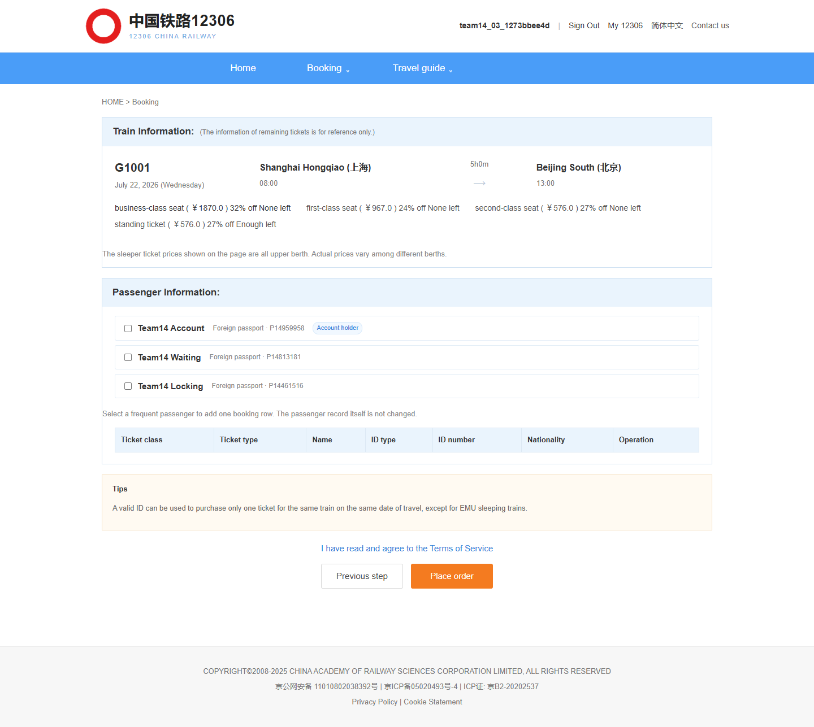
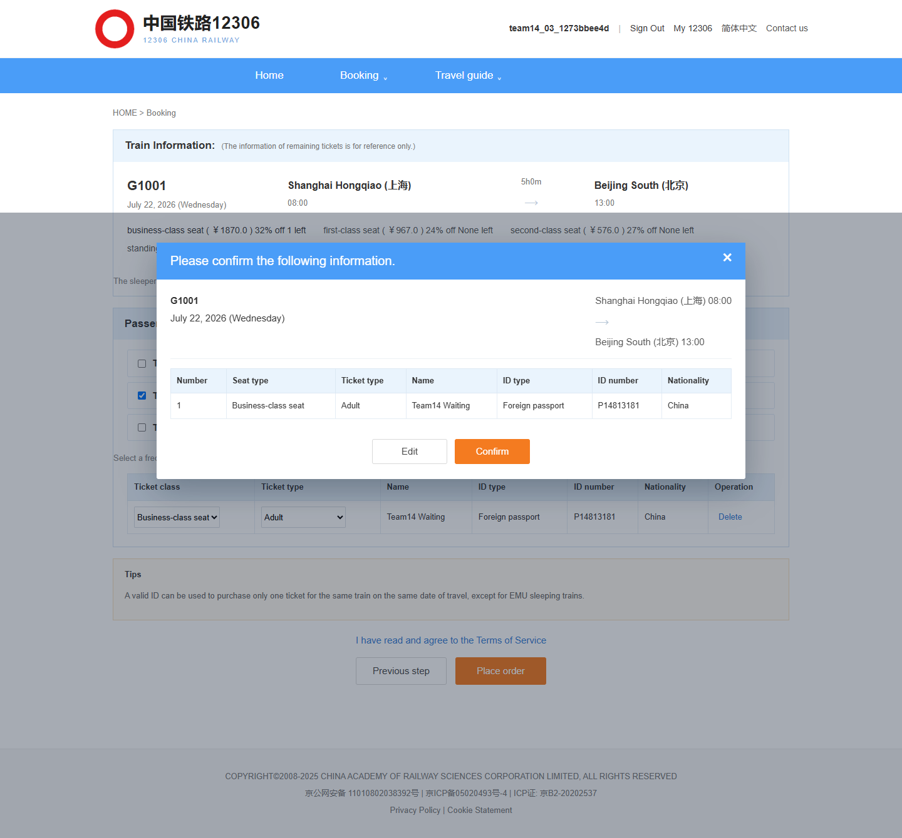
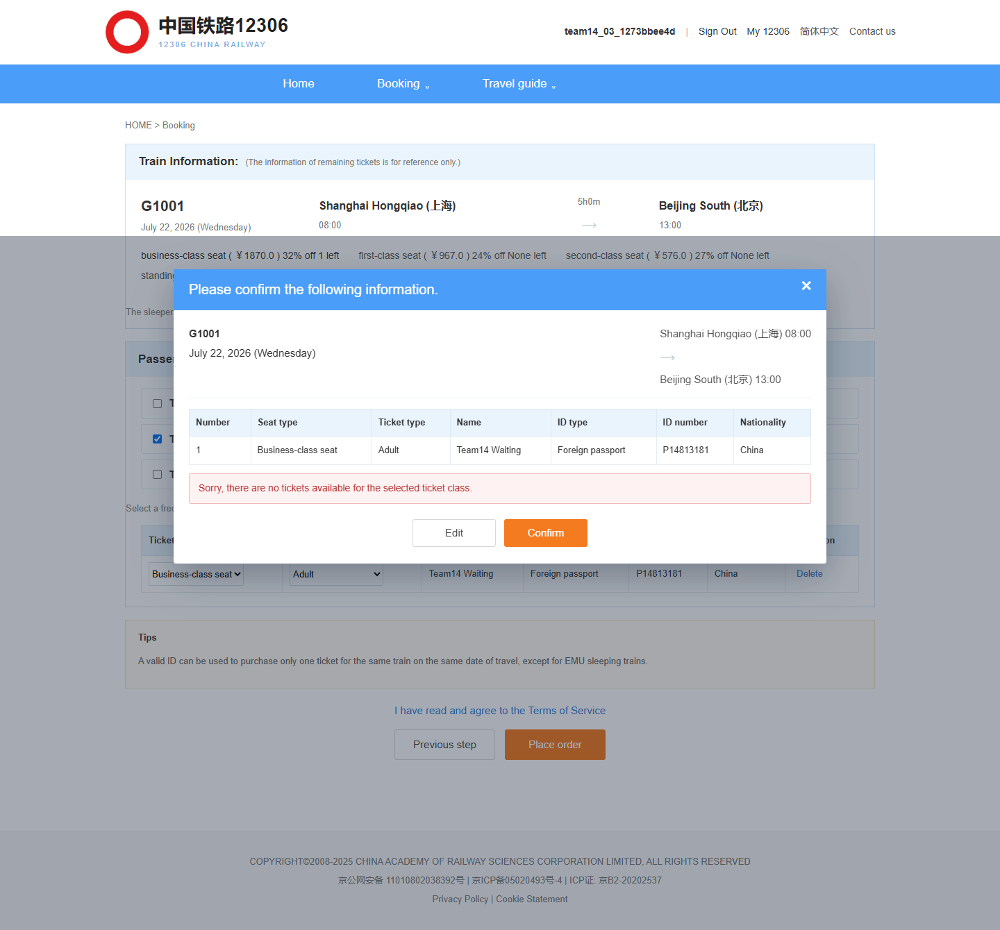

# 03 余票耗尽后旧标签页仍打开订单确认框

## 测试方法与代码路径

采用白盒状态变化路径测试。[`frontend/js/pages-search.js`](../../frontend/js/pages-search.js) 在 391–395 行将预订页数据中的 fares 保存到当前页面闭包，Place order 的点击处理在 472–491 行使用这个快照检查 `counts[cls] > fares[cls].available`，通过后调用 openConfirmation。

选择同一账号的两个标签页和两个不同乘客，先让 A 页面缓存一张商务座的余票，再让 B 页面完成 Confirm 锁住该座位，最后回到 A 点击 Place order。输入使“页面快照仍为 1、当前可用数量已为 0”的条件成立。

[`backend/app.py`](../../backend/app.py) 的 `_create_order` 在 736–739 行会重新核对数量。自动化同时记录这次较晚的拦截，以界定故障发生的阶段。

## 需求与现有测试差异

[REQ-8.3.2](../../requirements/requirements.yaml) 要求 Place order 校验乘客和当前席别库存，售罄席别应拒绝且不打开确认框。REQ-8.4 规定 Confirm 后进入锁座付款倒计时。需求数据约定每个预订账号有独立的一张商务座配额，本例两个页面共享同一个账号。

[REQ-8.3.2.spec.ts](../baseline/REQ-8.3.2.spec.ts) 检查页面打开时就已售罄的席别和有效席别。[REQ-8.3.3.1.spec.ts](../baseline/REQ-8.3.3.1.spec.ts) 与 [REQ-8.7.spec.ts](../baseline/REQ-8.7.spec.ts) 分别检查确认、取消释放。它们使用单页面准备与提交。本例增加了页面打开后，同账号另一标签页改变余票的状态路径。

## 前置条件与复现步骤

1. 按 [团队 README](README.md) 注册并登录独立账号，例如用户名 `team14_manual03`、账号护照 `P14000013`。
2. 在 My Passengers 添加两名不同乘客，分别为 `Team14 Waiting / P14000004` 和 `Team14 Locking / P14000005`。其他字段使用 Nationality China、Passport expiration date `2028-12-31`、Date of birth `1999-02-20`、Gender Male、Email address `team14.passenger@example.com`、Mobile number `13800000043`、Passenger type Adult。
3. 在标签页 A 中，通过 Home 查询 Shanghai → Beijing、日期 `2026-07-22`，点击 G1001 行的 Book。确认 business-class seat 显示 1 left。
4. 选择 Team14 Waiting，保持 Ticket class 为 Business-class seat、Ticket type 为 Adult。保留该页面。
5. 在同一浏览器会话的新标签页 B 打开应用，查询同一日期与 G1001，进入 Book，选择另一名乘客 Team14 Locking，使用 Business-class seat，点击 Place order，再点击确认框中的 Confirm。
6. 在 B 确认付款页有锁座倒计时。通过 Home 再查询同一服务并进入 Book，确认 business-class seat 已显示 None left。
7. 返回仍保留原页面的 A，直接点击 Place order，观察是否打开 Please confirm the following information.。
8. 若确认框出现，点击其中的 Confirm，记录随后显示的缺票错误。
9. 清理时，在 B 打开 My 12306 → Ticket orders，找到步骤 5 建立的订单，点击 Pay 进入原付款页，再点击付款页 Cancel，确认 Order cancelled successfully.。

## 预期与实际

预期步骤 7 显示 Sorry, there are no tickets available for the selected ticket class.，保留预订页并拒绝打开确认框。

实际 B 已显示商务座 None left，但 A 仍使用 1 left 的旧快照，Place order 后打开了包含商务座乘客的确认框。点击 Confirm 后才收到 HTTP 400 和缺票错误。观察到的差异是库存校验延迟到确认提交阶段。[两个页面的余票、确认框状态与响应](assets/results.json)

## 证据与复现命令

按团队 README 安装依赖、启动应用并设置 BASE_URL 后执行 `node reproduce.cjs 03`。脚本会完成取消清理，再在“售罄后 Place order 不应打开确认框”的断言处失败。
