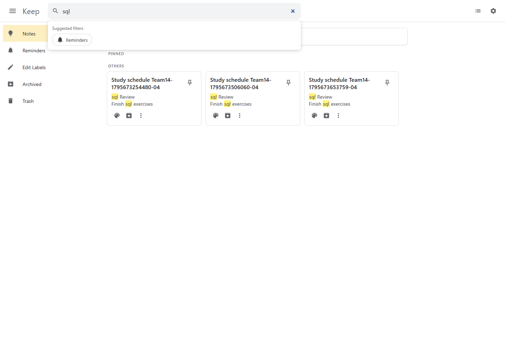
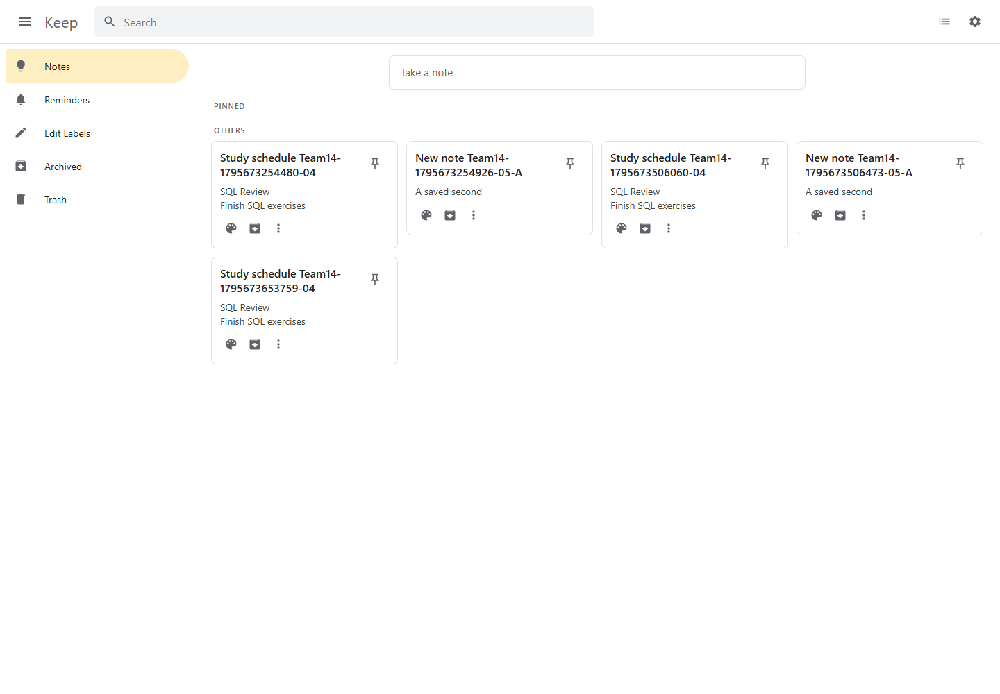

# 04 搜索高亮改写便签内容的大小写

## 方法与需求

白盒输入选择。检查 [`frontend/app.js`](../../frontend/app.js) 的 highlightContent 后，选择内容中为大写 SQL、查询为小写 sql 的输入。该函数通过小写副本查找匹配位置，却把查询 q 插入 mark，原文匹配片段的大小写因此丢失。

[REQ-4.1](../../requirements/requirements.yaml) 要求按标题或内容执行大小写不敏感搜索，每个高亮区域显示匹配的文本。结合 REQ-2.2 的保存内容契约，搜索结果中的高亮片段应保留原文 SQL。

## 与现有测试的差异

[REQ-4.1.spec.ts](../baseline/REQ-4.1.spec.ts) 使用查询 st，并用 `/^st$/i` 检查高亮，大小写不敏感的断言会接受被改写的片段。本例对搜索中的完整内容做区分大小写的精确断言，并以清空搜索后恢复原文为对照。

## 前置与步骤

1. 按团队 README 打开隔离测试实例，进入 Notes。
2. 点击 Take a note，在 Note editor 中输入 Title `Study schedule Team14-R001`，Content 输入两行 `SQL Review` 和 `Finish SQL exercises`，点击 Close。
3. 确认该便签的内容保留两个大写 SQL。
4. 在 Search 中输入小写 `sql`，观察便签内容与两个高亮片段。
5. 清空 Search，再观察同一便签内容。

## 预期与实际

预期搜索时便签仍显示 `SQL Review` 和 `Finish SQL exercises`，两个 SQL 高亮。清空搜索后内容继续保持原样。

实际搜索时显示 `sql Review` 和 `Finish sql exercises`，清空搜索后两个 SQL 又恢复大写。保存内容与搜索渲染结果的差异可稳定复现，影响发生在搜索显示阶段。[实际文本与高亮片段](assets/results.json)

按团队 README 准备环境后运行 `node reproduce.cjs 04`。正确行为断言在搜索中完整内容与已保存内容的精确比较处失败。
