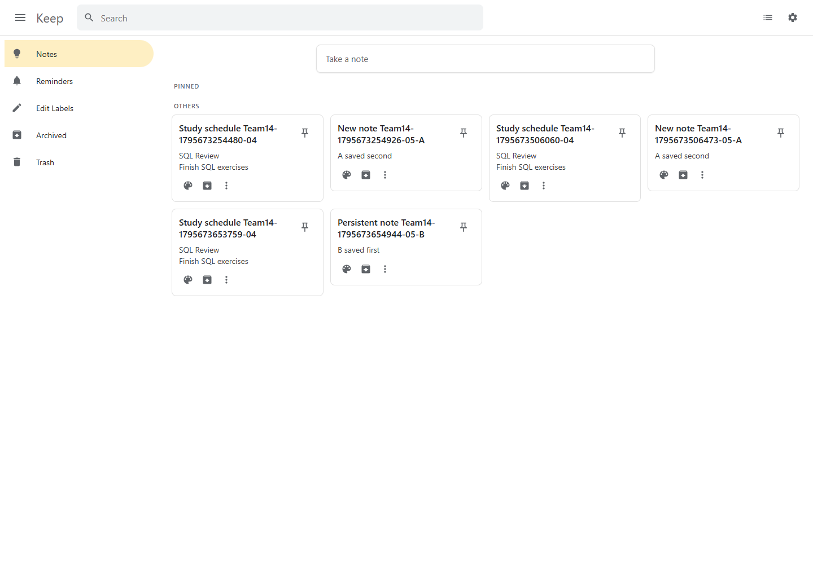

# 05 旧标签页新增便签覆盖已保存的另一条便签

## 方法与需求

白盒状态变化路径测试。[`frontend/app.js`](../../frontend/app.js) 的 initState 在打开页面时加载 state，closeEditor 把新便签加入该页面持有的数组，saveShared 再将整份 state 写入 [`shared-store.js`](../../frontend/shared-store.js) 的共享存储。写入前使用的集合可能早于其他页面已经完成的保存。

输入路径为两个标签页都打开同一应用实例，B 先完成新增和刷新验证，A 随后新增，两个页面最后都刷新。顺序操作使覆盖差异可复现。

[REQ-2.2](../../requirements/requirements.yaml) 要求新增便签持久化并在刷新后保留。REQ-2.1 要求每条活跃便签在对应列表出现一次。这里在同一实例中新增两个不同标题的便签，应同时保留。

## 与现有测试的差异

[REQ-2.2.spec.ts](../baseline/REQ-2.2.spec.ts) 在同一个页面完成创建和刷新。它覆盖首次持久化，没有覆盖另一页面已保存新数据之后旧页面再保存的路径。本例增加第二个标签页，并在 A 操作前先证明 B 的便签已经持久化。

## 前置与步骤

1. 按团队 README 启动测试专用状态文件实例。
2. 同一浏览器的 A、B 两个标签页都打开该实例，等待 Take a note 可用。
3. 在 B 创建 `Persistent note Team14-R001-B`，Content 为 `B saved first`，点击 Close。刷新 B，确认便签仍存在。
4. 回到保留原页面的 A，创建不同标题 `New note Team14-R001-A`，Content 为 `A saved second`，点击 Close。
5. 刷新 A，检查两条便签。
6. 刷新 B，再检查两条便签。

## 预期与实际

预期两条不同标题的活跃便签同时保留，A、B 刷新后都能看到。

实际 B 的便签在步骤 3 刷新后存在。A 新增后刷新，B 的便签消失，A 的便签存在。再刷新 B，仍找不到它先前保存的便签。后一次保存使用的完整旧快照覆盖了另一页面创建的数据。[两次刷新前后的数量](assets/results.json)

按团队 README 准备环境后执行 `node reproduce.cjs 05`。正确行为断言在“B 已保存便签仍存在”处失败。
