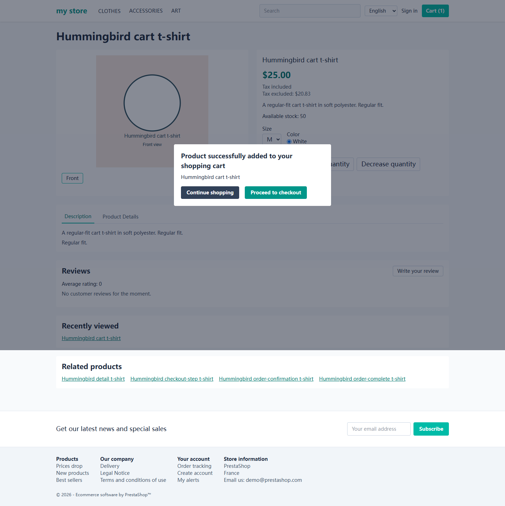
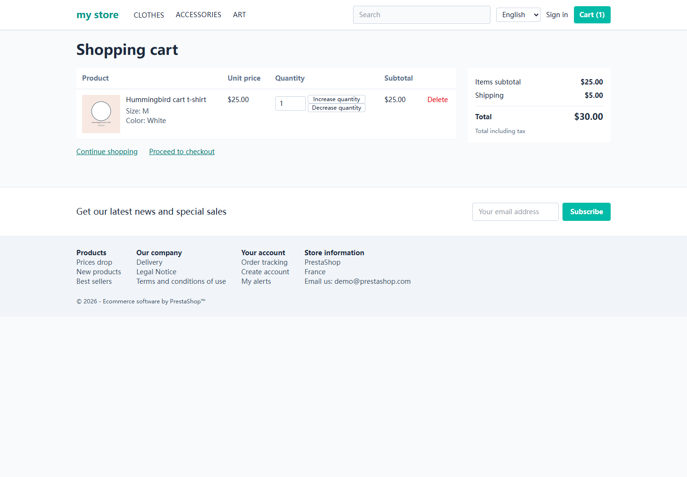

# 06 同款同规格再次加购显示成功但数量未累加

## 方法与需求

采用白盒路径测试。[`backend/src/slices/store.ts`](../../backend/src/slices/store.ts) 的 addToCart 查找 owner、productId、size、color 相同的既有项。首次加购进入 INSERT，第二次进入 UPDATE，但把 quantity 直接设为本次请求数量，覆盖了既有数量。

[REQ-3.3](../../requirements/requirements.yaml) 规定 Add to cart 显示成功弹窗并增加购物车数量。REQ-4.2 的数量调整规定该商品单价为 25，数量 2 的商品小计为 50，含运费总价为 55。这里选择两次各加一件，使同款同规格的第二次成功加购应把数量从 1 增至 2。

## 与现有测试的差异

[REQ-3.3.spec.ts](../baseline/REQ-3.3.spec.ts) 从空购物车加购一次，并分别检查继续购物和进入购物车。[REQ-4.2.spec.ts](../baseline/REQ-4.2.spec.ts) 在购物车内点击 Increase quantity。本例在第一次加购后点击 Continue shopping，再从商品详情对相同规格加购一次，覆盖 addToCart 的既有项更新分支。末尾保留购物车 Increase quantity 的正常行为作为对照。

## 前置与步骤

1. 按团队 README 启动应用。打开新的隐私窗口或独立浏览器上下文，保持匿名身份，确认 Cart (0)。
2. 在导航 CLOTHES 下打开 Men，再打开 Hummingbird cart t-shirt。
3. 保持默认 Size M、Color White、Quantity 1，点击 Add to cart。
4. 确认 Product successfully added to your shopping cart 弹窗显示成功，导航为 Cart (1)。
5. 点击弹窗中的 Continue shopping，回到同一商品详情。保持 M/White 和 Quantity 1，再点击 Add to cart。
6. 确认第二次出现成功弹窗，观察导航数量，然后点击 Proceed to checkout 进入 Shopping cart。
7. 刷新购物车，检查该行数量、Subtotal 和 Cart summary。
8. 点击该购物车行的 Increase quantity，观察数量和金额变化作为对照。

## 预期与实际

预期两次各一件的成功加购后，Cart 为 2，M/White 商品行数量为 2，Subtotal 为 50，Shipping 为 5，Total 为 55，刷新后保留。

实际第二次显示成功后 Cart 仍为 1。刷新后数量仍为 1，Subtotal 为 25，Total 为 30。随后点击购物车 Increase quantity，数量正常变成 2，Subtotal 变成 50，Total 变成 55。[两次加购与正常对照的实际结果](assets/results.json)

按团队 README 准备环境后执行 `node reproduce.cjs`。正确行为断言在两次成功加购后的原始数量与 2 比较处失败。
